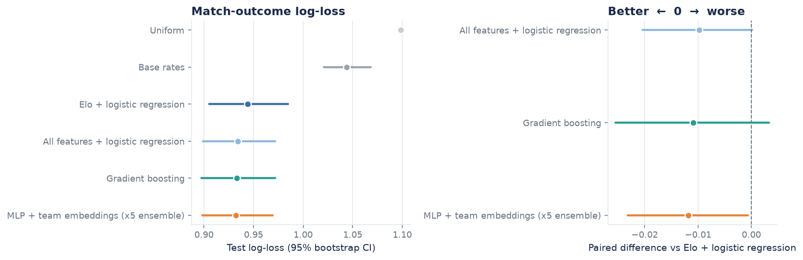
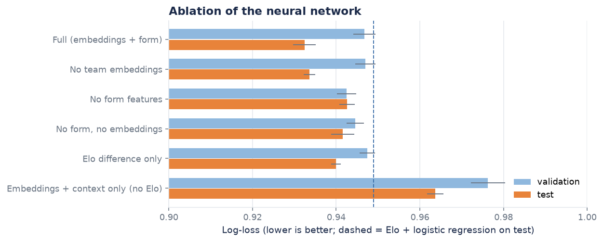
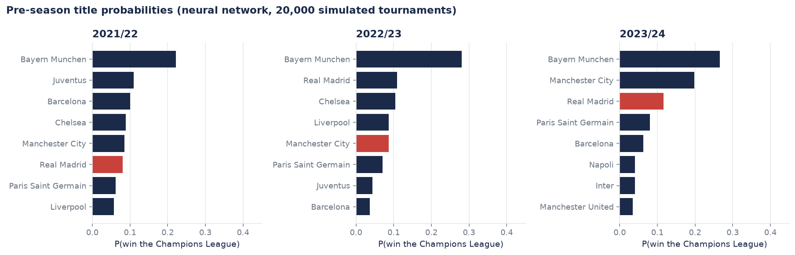

# Champions League forecasting: does deep learning beat Elo?

**Leakage-safe match-outcome models and Monte-Carlo tournament forecasts for the UEFA Champions League, built on open CC0 data (1992/93-2025/26), with an honest head-to-head between a neural network and simple baselines.**

 

## Headline result

On 753 held-out matches from 2021/22-2025/26 (strict chronological split, all models temperature-scaled on a validation window):

* A neural network with team embeddings (5-seed ensemble) reaches **0.9323 log-loss**, against **0.9441** for Elo + logistic regression and **1.0986** for uniform guessing.
* **It does not beat equally-informed baselines.** Versus a tuned logistic regression on the same features the difference is -0.002 (95% CI -0.007 to +0.003); versus gradient boosting -0.001 (-0.011 to +0.010). Only the gain over Elo-only is statistically visible (-0.012, CI -0.023 to -0.001), and the ablation shows it comes from engineered *form features*, not from the learned embeddings (removing embeddings: +0.001, inside seed noise).
* The probabilities drive a Monte-Carlo simulation of the whole tournament. On three held-out seasons, forecasts beat uniform clearly (stage-reach Brier 0.127 to 0.101), but the four informed models are indistinguishable from one another.

Conclusion: with roughly 2,900 training matches, a hand-built rating is hard to improve on, and deep learning is a fine model here but not a better one. Details, intervals and caveats below.



## Results

| Model (test: 753 matches) | Log-loss (95% CI) | Brier | RPS | Accuracy | ECE |
|---|---|---|---|---|---|
| Uniform | 1.0986 | 0.6667 | 0.2470 | - | - |
| Base rates (home/draw/away) | 1.0439 (1.021-1.068) | 0.6288 | 0.2374 | 48.9% | 0.007 |
| Elo + logistic regression | 0.9441 (0.905-0.985) | 0.5543 | 0.2006 | 56.8% | 0.033 |
| All features + logistic regression | 0.9343 (0.899-0.972) | 0.5494 | 0.1977 | 57.6% | 0.029 |
| Gradient boosting | 0.9332 (0.897-0.972) | 0.5481 | 0.1979 | 58.7% | 0.018 |
| **MLP + team embeddings (5 seeds)** | **0.9323** (0.898-0.969) | 0.5487 | 0.1980 | 57.1% | 0.026 |

Lower is better except accuracy. RPS = ranked probability score for the ordered outcome home < draw < away. ECE = class-wise expected calibration error. Single networks over seeds: 0.9324 +/- 0.0027.

| Ablation of the network (5 seeds, test log-loss) | |
|---|---|
| Full (embeddings + form) | 0.9324 |
| No team embeddings | 0.9336 |
| No form features | 0.9426 |
| Embeddings + context only, no Elo | 0.9637 |



**Tournament simulation** (2021/22, 2022/23, 2023/24; 20,000 simulated tournaments each, real group draws, constrained round-of-16 draw). Red = actual champion:



The network gave the eventual champion 8.0%, 8.6% and 11.6% (uniform: 3.1%). Three trophies are anecdotal; the 384 stage-reach events in notebook 04 are the more informative check.

## Quickstart

```bash
make setup      # Python 3.12 venv (uv) + pinned requirements
make data       # download + checksum-verify + parse the open data (~0.6 MB)
make test       # 57 tests, including the leakage proof
make notebooks  # re-executes all four notebooks (about 3 minutes on a laptop CPU)

.venv/bin/ucl-predict "Real Madrid" "Manchester City" --stage knockout
```

Requires [`uv`](https://docs.astral.sh/uv/) and Python 3.12 (TensorFlow has no wheels for 3.14 yet). No Kaggle account or API token is needed.

## Repository layout

```
src/ucl/            installable package
  data.py names.py    open-data download (pinned commits, SHA-256), parsers, club-name harmonisation
  features.py         walk-forward Elo / form features (RatingState)
  models.py           baselines + Keras MLP with team embeddings, ensemble, temperature wrapper
  evaluation.py       log-loss, Brier, RPS, ECE, temperature scaling, paired bootstrap
  simulation.py       Monte-Carlo bracket simulator
  predict.py          pydantic-validated inference API and CLI
  plotting.py         one consistent figure style
notebooks/          01 data + EDA | 02 features + baselines | 03 deep model + ablation + calibration | 04 simulation
tests/              leakage, features, metrics, models, simulation, data, predict
models/ucl_mlp/     saved artifact (5 networks, temperature, rating snapshot; ~0.5 MB)
reports/            figures and the JSON results the notebooks produce
docs/               DATA_CARD.md, MODEL_CARD.md
```

## Method in one page

1. **Problem framing.** A season has one champion, so a season-level network would have 34 labels. Instead, predict the 90-minute result of each match from pre-match information (about 4,100 labels) and obtain winner probabilities by simulating the bracket.
2. **Data.** Two CC0 repositories (footballcsv for 1992-2011, openfootball for 2011-2026), pinned to commits, parsers cross-validated on the overlap (497/500 identical; 3 finals listed in opposite order). Qualifying rounds excluded. See [docs/DATA_CARD.md](docs/DATA_CARD.md).
3. **Leakage-safe features.** On every match day, features of all matches are read from a rating state *before* that day's results are applied. A test corrupts every future result with random scores and asserts that all earlier features are bit-for-bit unchanged. The same state object powers training, inference and simulation.
4. **Split.** Train 1992/93-2016/17, validation 2017/18-2020/21 (early stopping, hyper-parameters, temperature), test 2021/22-2025/26 (touched for reporting only).
5. **Models.** Uniform, base rates, Elo + logistic regression, all-features logistic regression, gradient boosting, and an MLP with a shared team-embedding table, with comparable tuning budgets, 5 seeds, early stopping, and a paired bootstrap for differences.
6. **Calibration.** One temperature per model fitted on validation data; reliability diagrams and ECE reported (it helps little: the models were already roughly calibrated).
7. **Simulation.** Frozen pre-season ratings, real group draw, UEFA-constrained round-of-16 draw, two-legged ties with leg-specific probabilities, neutral final; goal margins from the empirical distribution; extra time and penalties as a coin flip.

## Limitations

Small data and wide intervals (differences below ~0.01 log-loss are not detectable); only Champions League results are used (no domestic form, squad data or odds, so no comparison with the betting market); simulation simplifications; three simulated seasons; regime changes (closed-doors 2020/21, Lisbon 2020, league phase from 2024/25). One untuned prototype's test score was seen during development; every reported choice was made on validation data. Full list in [docs/MODEL_CARD.md](docs/MODEL_CARD.md) and notebook 04. Not for betting.

## Reproduction and runtimes

Everything is seeded (global seed 2026; network seeds 2026-2030) and TensorFlow runs with deterministic ops: a fresh environment reproduced the test metrics **bit for bit**. Measured wall-clock on an Apple-silicon laptop CPU (no GPU): notebook 02 about 53 s (60-point Elo grid search), notebook 03 about 106 s (12-trial search, 5 seeds, 6x5 ablation), notebook 04 about 16 s (15 x 20,000 simulated tournaments), 5 networks train in ~11 s. TensorFlow/Keras 3 was used (it installs cleanly on Apple silicon); versions are pinned in `requirements.txt`.

## License

MIT, see [LICENSE](LICENSE). The data are CC0 (see the data card).
